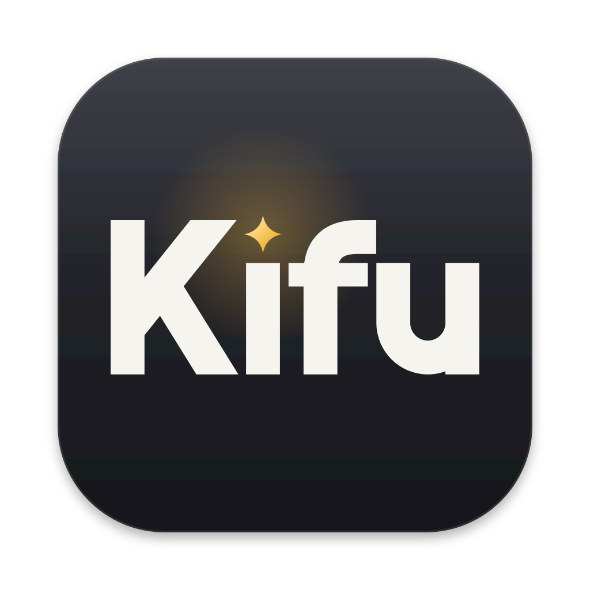
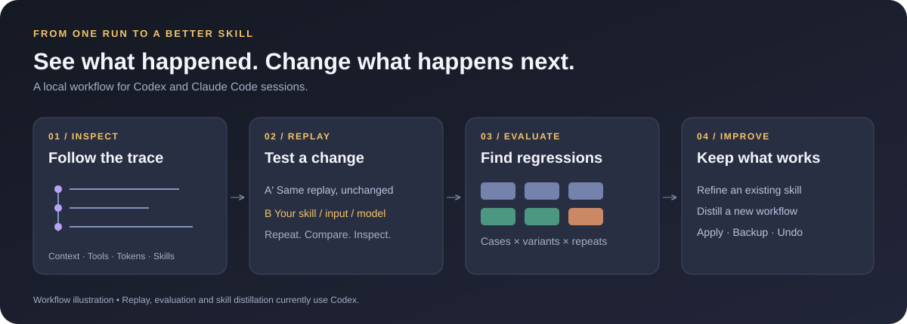
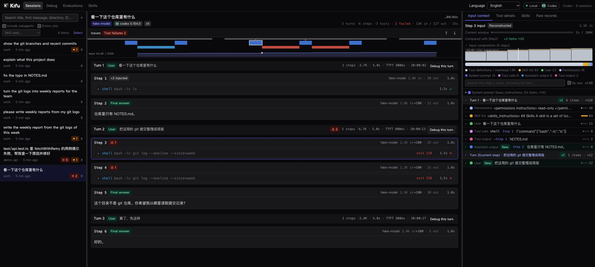

<div align="center">
  
  <h1>Kifu · 棋谱</h1>
  <p><strong>每一步都看得见，每一手都能重下。</strong></p>
  <p>面向 AI 编程 Agent 的本地调试与技能工作台。</p>
  <p><a href="#两分钟体验">体验演示</a> · <a href="#你能用它解决什么">功能</a> · <a href="#选择你的使用方式">快速开始</a> · <a href="README.md">English</a></p>
  <p>
    <a href="https://github.com/ggminfan/kifu/actions/workflows/ci.yml"></a>
    <a href="LICENSE"></a>
    
    
  </p>
</div>

Agent 漏掉了某个 skill、反复运行失败的命令，或者把上下文塞满了。**Kifu 帮你找到出问题的那一轮，再验证修改是否真的有用。**

打开会话，检查模型输入与工具调用，修改 skill、提示词或模型后回放；再把同一项改动放到一组用例上评测。确认有效后应用，自动备份，支持撤销。

*棋谱记录每一步，也让你有机会重新推演。*





<sub>合成会话演示，界面为英文；会话原文保持原始语言。</sub>

## 你能用它解决什么

| 你遇到的问题 | Kifu 提供的能力 |
| --- | --- |
| **它为什么这样执行？** | 沿时间线查看轮次、模型调用、工具参数与输出；检查重建上下文、token 增长、缓存命中和压缩。 |
| **我的 skill 为什么没被用上？** | 查看 skill 是否被列出、加载、截断或可能漏触发，并核对启发式判断的依据。 |
| **这样修改真的更好吗？** | 修改输入、skill 或模型后回放 Codex 会话，与不改动的回放基线 A′ 多次对比。 |
| **修好一个问题，会不会影响别处？** | 在正例、反例和对照用例上评测，查看回归、召回、误触发，以及可选的模型评分。 |
| **能不能不再反复解释同一件事？** | 把重复工作流和澄清提炼成 skill 草稿，校验、评测、安装，支持撤销。 |

**本机与远端，同一个工作台。** 浏览 Codex 和 Claude Code 会话，在 macOS 应用中打开多个工作区，也能通过 SSH 连接开发机。

## 两分钟体验

演示无需 Agent 账号、私人会话或付费模型调用。

准备 **Node.js 22.22.1 或 24** 和 **pnpm 10.32.1**，克隆或下载本仓库后运行：

```bash
git clone https://github.com/ggminfan/kifu.git
cd kifu
pnpm install --frozen-lockfile
pnpm build
pnpm demo:replay
```

打开 **[127.0.0.1:7791](http://127.0.0.1:7791)**。演示使用合成会话和假 Agent，你可以依次尝试：

1. 打开会话，查看「输入上下文」和「技能」面板。
2. 点击「调试这一轮」，修改一个 skill 变体。
3. 回放未改动的基线和你的变体，对比结果。
4. 进入「评测」，把同一改动放到更多用例上验证。

演示用来体验产品流程，其中的模拟结果不代表真实模型表现。

## 选择你的使用方式

### 浏览器

```bash
# 开发模式：界面 5173，API 7788
pnpm dev

# 生产网页模式：界面和 API 均为 7788
pnpm build && pnpm start
```

默认读取 `~/.codex` 中的 Codex 会话。查看 Claude Code 会话：

```bash
KIFU_AGENT=claude pnpm start
```

可通过 `CODEX_HOME`、`CLAUDE_CONFIG_DIR`、`KIFU_ROOTS`、`CODEX_BIN`、`KIFU_HOME` 和 `KIFU_PORT` 配置扫描与运行路径。Kifu 自身的数据默认保存在 `~/.kifu`。

### macOS 桌面与 SSH

在 **Apple Silicon** Mac 上安装 Xcode Command Line Tools 和 **Python 3.9+**，然后运行：

```bash
pnpm desktop:build
open desktop/build/stable-macos-arm64/Kifu.app
```

首次启动默认不扫描本机。点击「启用本机」，或从 `~/.ssh/config` 及其 `Include` 自动发现主机，也可以手动填写名称、主机、用户名和端口。认证支持自动／免密、身份文件（可填密钥口令）和密码。密码或口令仅保留在当前连接的内存中，只保存连接设置；首次连接仍需确认主机指纹。SSH 工作区在远端运行，使用那台机器上的 Agent 和登录；桌面构建包含 Linux x64 / arm64 服务端包。

安装包位于 `desktop/artifacts/stable-macos-arm64-Kifu.dmg`。本地构建尚未配置 Apple 开发者签名和公证。

### 中英文切换

首次启动读取系统首选语言：**简体中文系统使用简体中文，其他语言（包括繁体中文）使用英文**。在桌面「设置」或浏览器页面的语言选择器中，可切换「跟随系统」「English」「简体中文」。选择会被保留，桌面各工作区同步切换，无需重启。会话原文、代码和 skill 内容保持原样。

## 一个值得反复使用的流程

**“我的周报 skill 没有触发。”**

先看那一轮的 skill 列表：描述是否存在？触发词是否被截断？创建变体，把关键触发条件提前，与 A′ 回放对比。再加入相关正例、反例和对照用例，确认后应用改动。

最后一步很重要：更容易触发，也可能意味着在不该触发时被调用。Kifu 让你看见这种取舍。

## 支持范围与边界

| 能力 | Codex | Claude Code |
| --- | :---: | :---: |
| 会话与子 Agent 浏览 | ✓ | ✓ |
| 时间线、工具与上下文查看 | ✓ | ✓ |
| Skill 目录与变体 | ✓ | ✓ |
| 轮次回放和评测 | ✓ | — |
| Skill 列表预览、模型辅助提炼 | ✓ | — |

- 会话浏览在本地完成。**回放、分析、评分和提炼会调用你配置的 Codex CLI**，可能向模型提供方发送上下文并消耗额度。Claude Code 工作区的「问为什么」也使用 Codex。
- SSH 会话内容通过隧道传到本机显示。
- 历史上下文由记录重建，可能与模型实际输入不同；skill 信号是启发式判断，回放结果也存在随机性。建议用多次 A′ 基线判断改动效果。
- 回放默认使用隔离 Agent home 和只读工作区。开启外部工具、原地写入或应用 skill 会改变实际权限与数据。
- Kifu 面向可信电脑上的本地使用，不是多租户托管服务。详见[安全政策](SECURITY.md)。

## 一起改进

欢迎贡献**合成解析 fixture、Agent 版本兼容修复、更清晰的诊断、翻译改进和可复现的问题报告**。请勿在 issue 中上传真实会话和凭证。

```bash
pnpm check                 # 类型、翻译覆盖、测试、前端构建
pnpm audit:dependencies    # 已知依赖漏洞
pnpm build:server          # macOS arm64 + Linux x64 / arm64
```

[贡献指南](CONTRIBUTING.md) · [架构与详细使用文档](docs/guide.zh-CN.md) · [国际化说明](docs/I18N.md) · [更新记录](CHANGELOG.md) · [发布清单](docs/RELEASING.md)

**如果 Kifu 帮你看懂或改进了一次 Agent 执行，欢迎给仓库一个 Star。** 这能让更多 Agent 开发者发现它；一个清晰的复现或有价值的 fixture，也能让项目变得更好。

## 许可证与致谢

**代码：[MIT](LICENSE) © Liam。** Kifu 名称、字标和应用图标适用单独的[品牌与图形政策](TRADEMARKS.md#简体中文)。允许真实介绍、本地构建和明确标注来源的原版分发；另行分发修改版应用须使用自己的品牌或取得书面许可。该政策不代表商标已注册。

使用 React、Hono、CodeMirror、Bun、Electrobun 等[开源组件](THIRD_PARTY_NOTICES.md)。

Kifu 是独立项目，不代表 OpenAI 或 Anthropic 官方。
